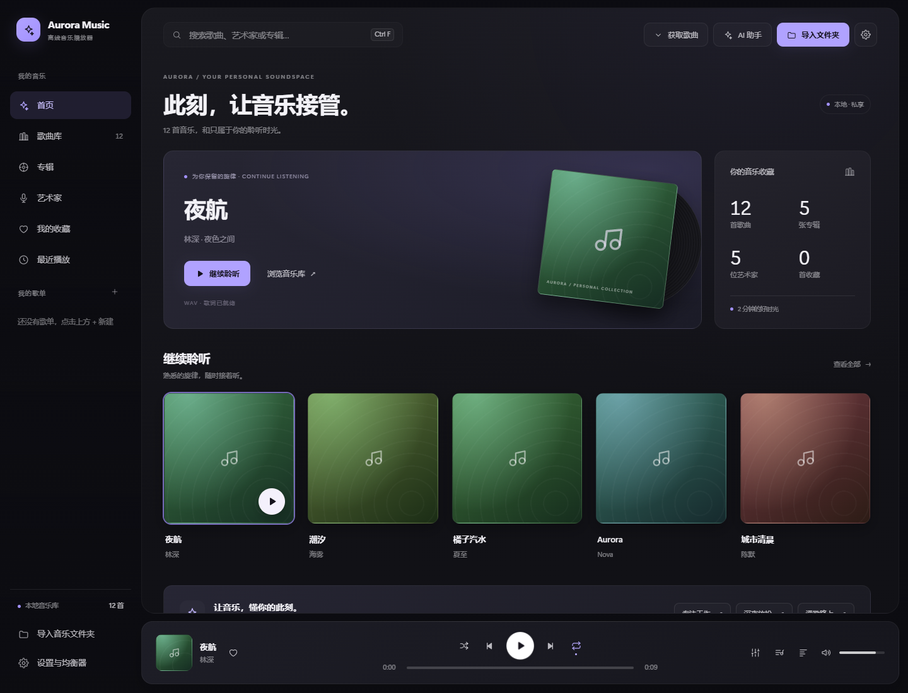

<p align="center"></p>

# Aurora Music

面向 Windows 的本地音乐播放器，使用 **Electron + React + TypeScript** 构建，同时保留浏览器版。支持本地曲库、同步歌词、封面补全、歌单管理与 DeepSeek 音乐助手。

[下载 Windows 版](https://github.com/bakrilivas-boop/aurora-music/releases/latest) · [提交问题](https://github.com/bakrilivas-boop/aurora-music/issues) · [MIT License](LICENSE)



*界面预览使用合成音频样本；发布包不含示例音频，缺失封面由界面即时生成占位图。*

## 功能

- **本地音乐库**：读取音频标签、内嵌封面和歌词；按歌曲、专辑、艺术家浏览，支持搜索、收藏、最近播放与自定义歌单。
- **歌词与封面**：读取同名 LRC 和同目录图片，支持时间轴歌词、点击跳转；桌面版可自动补全缺失资料。
- **播放控制**：顺序、随机、列表循环、单曲循环，音量、静音、十段均衡器与实时频谱。
- **队列管理**：拖动排序、逐条移除和清空，调整顺序不打断当前播放。
- **桌面体验**：独立窗口、托盘、系统媒体控制、快捷键、主题色与减少动态效果；设置自动保存并在重启后恢复。
- **精致深色界面**：大封面首页、分层面板、悬浮播放条、分类设置与轻量过渡；缺失封面显示稳定的色彩占位图，场景入口可直接填写 AI 提问。
- **歌单获取与下载**：解析网易云、QQ 音乐公开歌单；批量选择、进度、取消与失败重试，成功保存的歌曲自动加入曲库，重启后可直接播放。
- **DeepSeek 音乐助手**：自然语言点歌、曲库问答、播放控制、按心情和场景推荐、新建歌单，以及保留全部成员的歌单顺序整理。操作先预览，确认后执行。
- **大列表处理**：歌曲和队列使用可见区域渲染；标签与时长读取限制并发，音频从本地按段读取。

## 下载与安装

在 [Releases](https://github.com/bakrilivas-boop/aurora-music/releases) 下载：

- `Aurora-Music-<版本>-Setup.exe`：适用于 Windows x64，双击安装，可选择安装位置。
- `Aurora-Music-<版本>-Portable.zip`：解压后运行 `win-unpacked/Aurora Music.exe`，请保留整个目录。
- `SHA256.txt`：用于核对文件完整性。

桌面成品自带运行环境，无需另装 Node.js。发布包不包含音乐文件、个人曲库、设置或 API Key。换电脑后需要导入自己的音乐，并按需配置 DeepSeek。

## 使用

1. 点击「导入文件夹」选择本地音乐；双击歌曲开始播放。
2. 从底部播放条打开「正在播放」，查看封面、同步歌词和频谱。
3. 顶部「获取歌曲」粘贴公开歌单链接，读取后选择曲目加入下载队列；下载成功自动合并入库，不替换已有下载歌曲和手动曲库。
4. 顶部「AI 助手」或 `Ctrl+K` 打开 DeepSeek 设置，填写自己的官方 API Key，保存并验证后使用。

AI 使用 DeepSeek 官方 `https://api.deepseek.com`，调用模型为 `deepseek-flash`。只发送问题、近期会话与曲库文字标签，不上传音频或本地文件路径。Key 通过 Electron 安全存储加密，保存在本机用户数据目录，不回填到页面。

心情、场景推荐依据歌名、歌手、专辑与风格标签，不分析声音。当前每次最多向模型提供 300 首候选标签，超过时会披露筛选范围。

## 开发

需要 **Node.js 22 或更新版本**、npm；桌面运行与 Windows 打包请使用 Windows 环境。

```powershell
git clone https://github.com/bakrilivas-boop/aurora-music.git
cd aurora-music
npm ci
npm run check
npm run app
```

`npm run check` 会执行类型检查、测试和界面构建。`npm run app` 使用已经生成的 `dist` 启动 Electron。

浏览器开发：

```powershell
npm run dev
```

默认地址为 `http://127.0.0.1:5273`。浏览器版提供本地播放与曲库界面，原生下载、在线资料补全和 DeepSeek 桥接需要桌面版。

| 命令 | 用途 |
| --- | --- |
| `npm run typecheck` | TypeScript 检查 |
| `npm test` | 解析、播放、存储、下载和 API 边界回归 |
| `npm run build` | 生成界面到 `dist` |
| `npm run app` | 启动桌面版 |
| `npm run dist:win` | 生成 Windows 安装包和 `release/win-unpacked` |
| `node scripts/verify-release.mjs` | 核对包内源码、资源和版本，排除 QA 数据 |
| `node scripts/desktop-smoke.mjs` | 使用隔离数据目录验证桌面启动 |

`npm run dist:win` 不自动生成绿色 ZIP；将完整 `release/win-unpacked` 目录压缩即可。打包前请关闭从该目录启动的应用。测试使用模拟接口和生成的样本，无需真实 API Key，不会下载真实歌曲。

## 数据与使用边界

- Windows 默认数据目录为 `%APPDATA%/Aurora Music`，包含音乐索引、歌单、收藏、偏好、资料缓存和加密 Key。备份时同时保留此目录和原始音频。
- 手动曲库沿用浏览器文件系统授权机制；显示「恢复访问」时需点击重新授权。自动入库的下载文件由桌面端恢复访问。
- 下载最多并发 2 首，单首上限 200 MiB；同名文件不覆盖。退出会取消未完成任务，当前不支持跨重启断点续传。
- 音源解析依赖外部平台或可配置的备用接口，可能因登录、会员、版权、地区、接口变更或限流而不可用。请仅获取和使用你有权下载的内容；本仓库不提供音乐文件、账号或访问凭证。
- MP3、FLAC、M4A、OGG 等标签支持范围和实际解码能力不同；Chromium 不保证支持所有音频编码，后缀被识别不代表一定能播放。
- 自动封面和歌词只在严格匹配成功时采用；没有可靠结果时可以使用自己的同名 LRC 和图片。

## 项目结构

```text
src/          React 界面、状态、音频与标签解析
electron/     原生窗口、设置、下载、本地媒体服务与 AI 桥接
scripts/      回归测试、启动检查与构建辅助脚本
build/        应用图标
```

## 许可与致谢

Aurora Music 源码采用 [MIT License](LICENSE)。依赖及参考项目说明见 [THIRD_PARTY_NOTICES.md](THIRD_PARTY_NOTICES.md)。该许可证不覆盖外部服务、歌曲、歌词、专辑图片或用户自行导入的内容。
